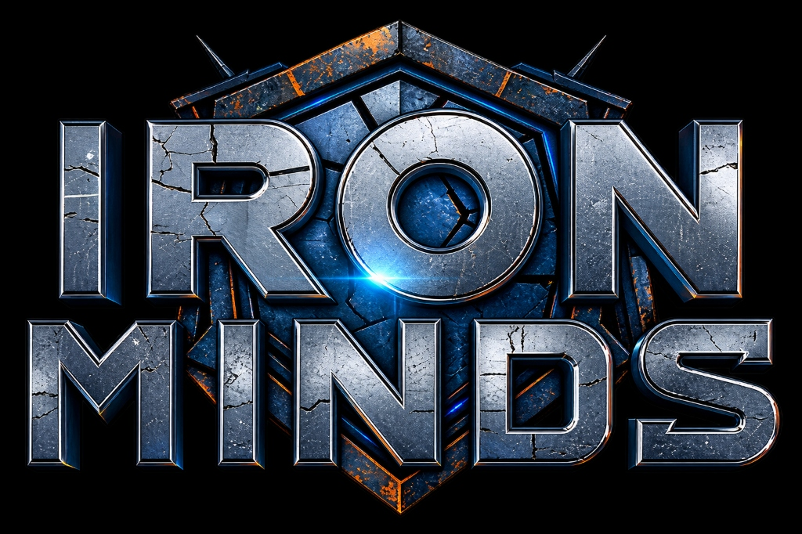
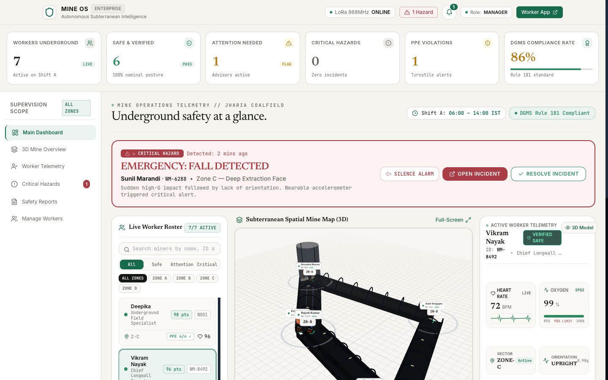
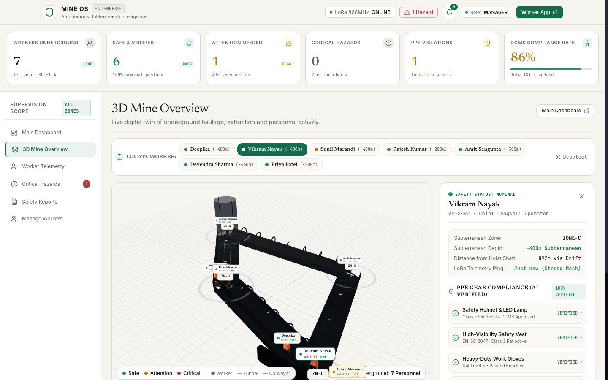
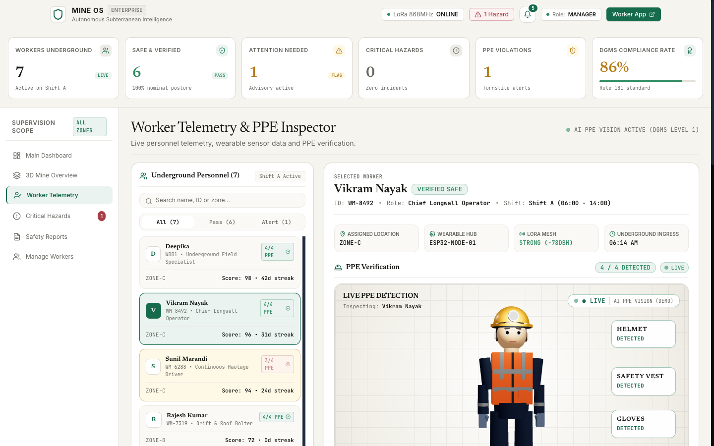
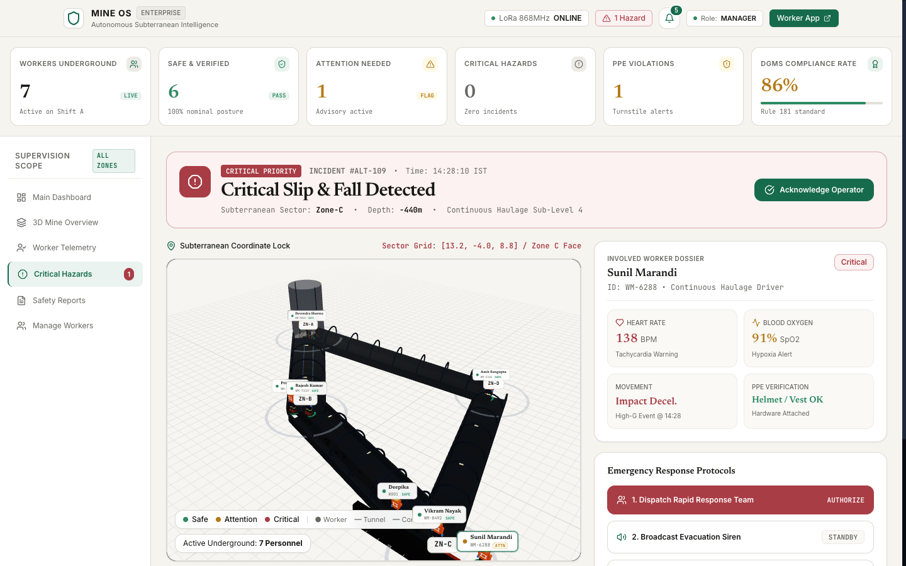
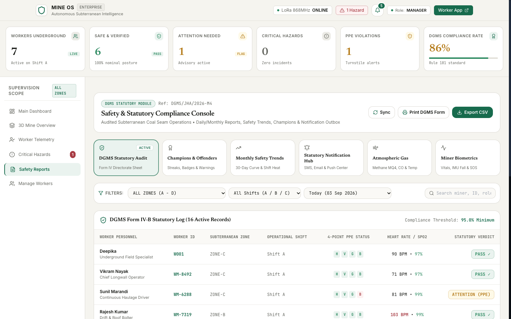
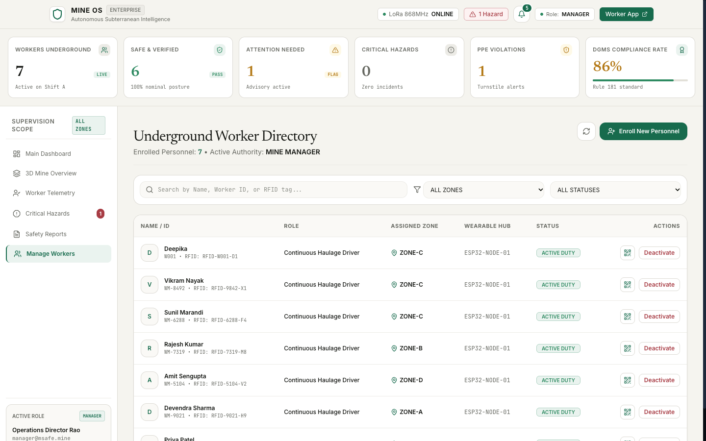
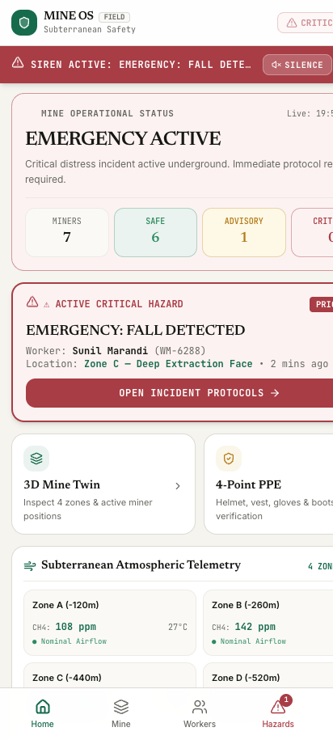
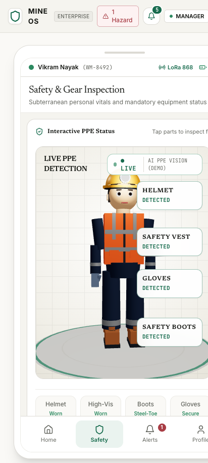
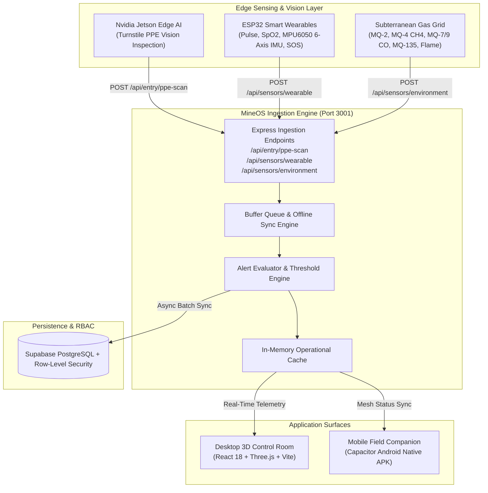

<div align="center">



# MineOS — Real-Time Subterranean Mining Safety & Environmental OS

> An industrial IoT and edge-computing safety platform integrating computer-vision PPE compliance, wearable worker telemetry, underground multi-gas sensing, and a 3D digital twin control room.

[](#)
[](LICENSE)
[](#)
[](#)
[](#)
[](#)
[](#)
[](MineOS.apk)

</div>

---

## Table of Contents

- [What the Project Does](#what-the-project-does)
- [Why the Project is Useful](#why-the-project-is-useful)
  - [Subterranean Mining Challenges](#subterranean-mining-challenges)
  - [Core Safety Capabilities](#core-safety-capabilities)
  - [DGMS Regulatory Compliance](#dgms-regulatory-compliance)
- [UI Showcase & Screenshots](#ui-showcase--screenshots)
  - [Central Control Room Dashboard](#central-control-room-dashboard)
  - [Interactive 3D Subterranean Digital Twin](#interactive-3d-subterranean-digital-twin)
  - [Worker Biometrics & 3D PPE Verification](#worker-biometrics--3d-ppe-verification)
  - [Critical Incident Command & Emergency Protocols](#critical-incident-command--emergency-protocols)
  - [DGMS Statutory Compliance Console](#dgms-statutory-compliance-console)
  - [Workforce Directory & Roster Management](#workforce-directory--roster-management)
  - [Mobile Field Companion Suite](#mobile-field-companion-suite)
- [System Architecture](#system-architecture)
- [Role-Based Access Control](#role-based-access-control-rbac)
- [Tech Stack](#tech-stack)
- [Project Structure](#project-structure)
- [How Users Can Get Started](#how-users-can-get-started)
  - [Prerequisites](#prerequisites)
  - [1. Backend Ingestion Engine](#1-backend-ingestion-engine)
  - [2. Multi-Sensor Telemetry Simulator](#2-multi-sensor-telemetry-simulator)
  - [3. Frontend Web Application](#3-frontend-web-application)
  - [4. Mobile Field Companion (Android APK)](#4-mobile-field-companion-android-apk)
  - [Demo Accounts & Authentication](#demo-accounts--authentication)
- [Edge Hardware Integration](#edge-hardware-integration)
- [Where Users Can Get Help](#where-users-can-get-help)
- [Who Maintains and Contributes](#who-maintains-and-contributes)
- [License](#license)

---

## What the Project Does

**MineOS** is an open-source, edge-to-cloud industrial safety operating system engineered for subterranean coal and mineral mines. It bridges the gap between deep extraction faces and surface supervisory control by consolidating:

1. **Edge Computer Vision:** Automated turnstile portal verification verifying 4-point Personal Protective Equipment (Helmet, High-Vis Vest, Heavy-Duty Gloves, and Steel-Toe Boots).
2. **Underground Sensor Grid:** Continuous environmental atmospheric monitoring ($CH_4$ Methane, $CO$ Carbon Monoxide, toxic gases, flame, and ambient temperature) across mining zones (`zone-a` to `zone-d`).
3. **Smart Wearable Telemetry:** Worker telemetry hubs tracking pulse, blood oxygenation ($SpO_2$), body temperature, 6-axis MPU6050 fall/impact vectors, and active distress triggers.
4. **Spatial 3D Digital Twin:** Surface control room interface rendered with React Three Fiber, providing interactive topographical depth views from $-120\text{m}$ to $-520\text{m}$ subterranean levels.
5. **Mobile Field Companion:** A native-packaged Android application (powered by Capacitor) allowing underground workers and shift foremen to access vitals, check zone gas readings, and transmit emergency beacons.

---

## Why the Project is Useful

### Subterranean Mining Challenges

Underground mining remains among the world's most hazardous occupations. Conventional operations suffer from critical vulnerabilities:
- **Unenforced Turnstile Compliance:** Manual visual inspections fail to prevent workers from entering shaft portals missing vital protection gear.
- **Delayed Atmospheric Detection:** Hazardous gases ($CH_4$ Methane, Carbon Monoxide, volatile organics) accumulate in unventilated chambers hours before surface managers are notified.
- **Incapacitation Latency:** Worker falls, rockburst impacts, or sudden medical crises (hypoxia, cardiac stress) often go undetected until end-of-shift muster rolls.
- **Subterranean Connectivity Gaps:** Deep rock strata frequently sever internet connections, causing conventional telemetry systems to drop critical sensor records.

### Core Safety Capabilities

- **Zero-Trust Portal Gating:** Edge inference on an Nvidia Jetson unit prevents gate release until all safety equipment is validated with photographic audit logging.
- **Impact & Inactivity Recognition:** 6-Axis IMU vector analytics distinguish regular operational movement from high-g impact decelerations followed by prolonged immobility.
- **Offline Resilient Buffer:** Dual-tier ingestion architecture queues readings locally during network dropouts and flushes batches automatically upon link restoration.
- **Instant Evacuation Dispatch:** Surface operators can trigger multi-zone sirens and broadcast emergency rescue orders with a single click.

### DGMS Regulatory Compliance

MineOS is built to align with statutory safety mandates governed by the **Directorate General of Mines Safety (DGMS)**:
- **DGMS Rule 181 Standard:** Automated real-time compliance rate tracking.
- **Form IV-B Statutory Log:** Daily and shift-by-shift auditable registries capturing PPE adherence, miner vitals, and statutory clearance verdicts.
- **Automated Export:** One-click CSV and print-ready export of statutory documentation.

---

## UI Showcase & Screenshots

### Central Control Room Dashboard

The primary supervisory console displays real-time subterranean metrics, active emergency banners, shift rosters, live 3D shaft topography, and selected worker telemetry.



---

### Interactive 3D Subterranean Digital Twin

Surface supervisors can navigate underground extraction galleries, track miner positions across zones (`-120m` to `-520m`), inspect ventilation airflows, and pinpoint localized hazards in 3D space.



---

### Worker Biometrics & 3D PPE Verification

Inspect individual miners with real-time biometric telemetry (Heart Rate, $SpO_2$, Body Temp), LoRa 868MHz mesh connection strength, and an interactive 3D PPE inspector validating equipment wear state.



---

### Critical Incident Command & Emergency Protocols

When a high-g impact, fall, or atmospheric spike is detected, the incident console locks coordinates on the 3D map, plots biometric warnings (tachycardia/hypoxia), and enables rapid rescue dispatch.



---

### DGMS Statutory Compliance Console

Automated registry generation adhering to DGMS Rule 181 and Form IV-B reporting. Features statutory audit tables, monthly safety trend curves, atmospheric gas logs, and CSV data export.



---

### Workforce Directory & Roster Management

Authorized supervisors manage underground personnel, configure RFID tags, bind ESP32 wearable hubs, assign mine zones, and review active duty status across shifts.



---

### Mobile Field Companion Suite

Field workers and underground foremen access a native mobile layout (Capacitor Android APK) featuring live safety posture, zone atmospheric readings, 3D interactive avatar inspection, and one-tap emergency SOS.

| Field Operations Dashboard | In-Mine 3D Gear Inspection |
|:---:|:---:|
|  |  |

---

## System Architecture



---

## Role-Based Access Control (RBAC)

MineOS enforces strict organizational role segregation:

| Role | Scope | Key Permissions |
|---|---|---|
| **Mine Manager** (`mine_manager`) | Entire Mine | Org-wide oversight, full roster management, personnel creation, emergency broadcast authorization. |
| **Safety Officer** (`safety_officer`) | Safety Audits | Cross-shift PPE audits, incident resolution, statutory reporting, safety streak tracking. |
| **Shift In-Charge** (`shift_incharge`) | Assigned Shift | Operational command across subterranean zones for active shift; incident acknowledgement. |
| **Mine Worker** (`mine_worker`) | Individual | Personal vitals telemetry, shift assignment details, 4-point PPE inspection, instant SOS distress beacon. |

---

## Tech Stack

| Domain | Technology Stack |
|---|---|
| **Frontend Framework** | [React 18](https://react.dev/), [TypeScript](https://www.typescriptlang.org/), [Vite](https://vitejs.dev/) |
| **3D Digital Twin** | [Three.js](https://threejs.org/), [@react-three/fiber](https://docs.pmnd.rs/react-three-fiber), [@react-three/drei](https://github.com/pmndrs/drei) |
| **Styling & UI Design** | [Tailwind CSS](https://tailwindcss.com/), [Lucide React](https://lucide.dev/), Glassmorphism tokens |
| **Mobile Runtime** | [Capacitor v6](https://capacitorjs.com/), Android SDK, Native Gradle Build Tooling |
| **Backend Server** | [Node.js](https://nodejs.org/), [Express](https://expressjs.com/), [tsx](https://github.com/privatenumber/tsx), TypeScript |
| **Persistence & Auth** | [Supabase](https://supabase.com/) (PostgreSQL), Custom RBAC Policies, In-Memory Local Cache fallback |
| **Edge & Sensor Protocols** | REST JSON Ingestion, LoRa 868MHz Mesh Simulation, Offline Resilient Queue |

---

## Project Structure

```
mineos/
├── android/                   # Capacitor native Android Studio project
│   ├── app/                   # Android source, manifests, Gradle configurations
│   └── build.gradle           # Root Gradle configuration
├── backend/                   # Node.js + Express real-time ingestion server
│   ├── src/
│   │   ├── config/supabase.ts # Cloud database connection & fallback handler
│   │   ├── routes/            # Ingestion endpoints (/api/entry, /api/sensors, /api/auth)
│   │   ├── services/          # Alert evaluator, in-memory tables, offline queue
│   │   └── server.ts          # Express server entry point (Port 3001)
│   ├── schema.sql             # PostgreSQL relational schema & RBAC definitions
│   └── simulator.js           # Multi-sensor telemetry generator (7 miners, 4 zones)
├── docs/                      # Technical documentation & assets
│   ├── screenshots/           # High-resolution UI captures of the platform
│   ├── API.md                 # Detailed edge ingestion API specifications
│   ├── CONTRIBUTING.md        # Developer workflow and contribution guidelines
│   └── SUPPORT.md             # Help resources and vulnerability reporting
├── public/                    # Static assets (Iron Minds branding logo & compiled APK)
│   ├── ironminds-logo.jpg     # Official IRON MINDS project logo
│   └── MineOS.apk             # Standalone installable Android application package
├── src/                       # React 18 frontend application
│   ├── components/            # UI components (controlroom, mobile, shared 3D canvas)
│   ├── context/               # AuthContext (RBAC) & SafetyContext (Live state)
│   ├── pages/                 # Route pages (Control Room, Mobile suite, Worker portal)
│   ├── services/              # Telemetry bridge & Supabase client bindings
│   ├── App.tsx                # Client application router & role protection
│   └── main.tsx               # Application root mount
├── MineOS.apk                 # Root Android release binary for direct download
├── capacitor.config.ts        # Capacitor configuration for Android runtime
├── package.json               # Root dependencies and scripts
└── vite.config.ts             # Vite build configuration
```

---

## How Users Can Get Started

### Prerequisites

- **Node.js**: v18.0.0 or higher
- **npm**: v9.0.0 or higher
- **Android Studio / SDK** *(optional)*: For building the mobile APK from source

---

### 1. Backend Ingestion Engine

Clone the repository and launch the backend ingestion server:

```bash
# Navigate to the backend directory
cd backend

# Install dependencies
npm install

# (Optional) Copy environment template for Supabase cloud configuration
cp .env.example .env

# Start the ingestion server in development watch mode
npm run dev
```

The backend server will initialize at `http://localhost:3001`. If Supabase credentials are not supplied, the server automatically starts in **Local In-Memory Mode**, providing full local functionality without external cloud dependencies.

---

### 2. Multi-Sensor Telemetry Simulator

In a separate terminal window, launch the multi-sensor simulator to broadcast live telemetry representing 7 subterranean miners and 4 mine zones:

```bash
cd backend
npm run simulate
```

The simulator streams:
- Worker heart rate, $SpO_2$, and body temperature every 3 seconds.
- 6-Axis accelerometer vectors with periodic simulated trip/fall events.
- Zone atmospheric gas concentrations ($CH_4$, $CO$, flame presence).

---

### 3. Frontend Web Application

In the root repository directory, start the Vite development server:

```bash
# Install frontend dependencies
npm install

# Start development server
npm run dev
```

Open your browser and navigate to:
```
http://localhost:5173
```

- **Desktop Viewports ($\ge 800\text{px}$):** Automatically route to the full **Control Room Operations Dashboard**.
- **Mobile Viewports ($< 800\text{px}$):** Automatically route to the **Mobile Field Companion Suite**.

---

### 4. Mobile Field Companion (Android APK)

MineOS includes a ready-to-install Android release binary:

- **Direct Download:** Access [`MineOS.apk`](MineOS.apk) in the repository root or download it directly from the running web interface.
- **Build from Source:**
  ```bash
  # Build frontend production bundle
  npm run build

  # Sync web bundle into native Android container
  npx cap sync android

  # Open in Android Studio to build APK or run on connected device
  npx cap open android
  ```

---

### Demo Accounts & Authentication

You can instantly switch between roles in the UI or authenticate with preconfigured credentials:

| Role | Email | Password | Scope |
|---|---|---|---|
| **Mine Manager** | `manager@msafe.mine` | *Any password or demo login* | Complete mine oversight |
| **Safety Officer** | `safety@msafe.mine` | *Any password or demo login* | Cross-shift safety & audits |
| **Shift In-Charge** | `incharge@msafe.mine` | *Any password or demo login* | Shift A subterranean operational view |
| **Mine Worker** | `worker@msafe.mine` | *Any password or demo login* | Worker W001 personal vitals & SOS |

---

## Edge Hardware Integration

Hardware engineers connecting physical devices can reference the standard JSON ingestion contracts:

- **Turnstile AI PPE Scan:** `POST /api/entry/ppe-scan`
- **Wearable Biometrics & IMU:** `POST /api/sensors/wearable`
- **Atmospheric Gas Grid:** `POST /api/sensors/environment`
- **Helmet Optical Detection:** `POST /api/sensors/helmet`

For detailed request schemas, parameter types, and example responses, consult the [docs/API.md](docs/API.md) specification.

---

## Where Users Can Get Help

- **Documentation & Endpoints:** Read the [Ingestion API Specifications](docs/API.md).
- **Contributing Guide:** Review [Contribution Guidelines](docs/CONTRIBUTING.md) for branch rules and testing procedures.
- **Community & Issue Tracking:** For bug reports, hardware driver questions, or field trials, see [docs/SUPPORT.md](docs/SUPPORT.md) or open an issue on GitHub.

---

## Who Maintains and Contributes

**Lead Maintainer:**
- **Nitikasri Jeyan Achary**
  - GitHub: [@NitikasriJeyanAchary0109](https://github.com/NitikasriJeyanAchary0109)
  - Email: `nitikasriachary0109@gmail.com`

Contributions from the open-source community are welcome! Please read [docs/CONTRIBUTING.md](docs/CONTRIBUTING.md) to get started.

---

## License

This project is licensed under the **MIT License**. See the [LICENSE](LICENSE) file for complete details.
